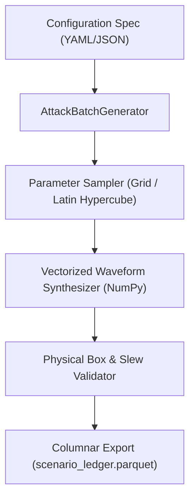

# Technical Architecture & Research Specification: High-Throughput Attack Scenario Generator

**Document:** `ATTACK_GENERATOR_SPECIFICATION.md`  
**Created:** 2026-11-11  
**Status:** Architecture Blueprint for Implementation  
**Target Module:** `src/attacks/massive_generator.py`  

---

## 1. Executive Research Scope & Motivation

Current inverse recovery benchmarks evaluate on discrete, hand-crafted scenarios (e.g., 50–180 scenarios). To rigorously test surrogate resilience, evaluate the theoretical limits of multi-order trend filtering, and maximize utilization of allocated HPC GPU quotas on TACC Vista, we establish the architecture for an automated **High-Throughput Attack Scenario Generator**.

The engine is designed to synthesize **$1,000$ to $10,000+$ attack trajectories** across five broad morphology categories:
1. Canonical Parameterized Profiles (Step, Ramp, Drift, Pulse, Sinusoid).
2. Complex Non-Linear Waveforms (Trapezoids, S-Curves, Harmonic Chirps).
3. Stochastic Non-Deterministic Drifts (Brownian random walks, Ornstein-Uhlenbeck).
4. Stealthy Gradient-Based Adversarial Perturbations (Time-Series PGD / FGSM).
5. Coordinated Multi-Sensor Manifold Attacks (Mass-balance spoofing).

---

## 2. Attack Taxonomy & Mathematical Formulations

Every attack instance corrupts supervisory SCADA observations:
$$\mathbf{y}_t = \mathbf{x}_t + \boldsymbol{\delta}_t, \quad t \in \{1, \dots, N\}$$

### 2.1 Category 1: Canonical Additive Profiles
1. **Piecewise Constant Step:**
   $$\delta_t = A \cdot \mathbf{1}_{[t_{\mathrm{on}}, t_{\mathrm{off}}]}(t)$$
2. **Linear Ramp:**
   $$\delta_t = A \cdot \left(\frac{t - t_{\mathrm{on}}}{t_{\mathrm{off}} - t_{\mathrm{on}}}\right) \cdot \mathbf{1}_{[t_{\mathrm{on}}, t_{\mathrm{off}}]}(t)$$
3. **Linear Accumulating Drift:**
   $$\delta_t = c \cdot (t - t_{\mathrm{on}}) \cdot \mathbf{1}_{[t_{\mathrm{on}}, N]}(t)$$
4. **Transient Pulse Shock:**
   $$\delta_t = A \cdot \mathbf{1}_{[t_{\mathrm{on}}, t_{\mathrm{on}} + \tau]}(t), \quad \tau \le 3\,\text{hours}$$
5. **Harmonic Resonance Sinusoid:**
   $$\delta_t = A \sin\left(\frac{2\pi (t - t_{\mathrm{on}})}{T_p} + \phi\right) \cdot \mathbf{1}_{[t_{\mathrm{on}}, t_{\mathrm{off}}]}(t)$$

---

### 2.2 Category 2: Complex Physical Waveforms
1. **Trapezoidal Profile (Ramp-Hold-Decay):**
   Models physical valve actuator slew limits during opening, holding, and closing:
   $$\psi(u) = \begin{cases} 
   \frac{u}{u_1}, & 0 \le u < u_1 \\
   1, & u_1 \le u < u_2 \\
   \frac{1 - u}{1 - u_2}, & u_2 \le u \le 1 
   \end{cases}, \quad u = \frac{t - t_{\mathrm{on}}}{T}$$
2. **Sigmoidal S-Curve:**
   Smooth non-linear saturation transition:
   $$\delta_t = A \left( \frac{1}{1 + e^{-k(t - t_0)}} - \frac{1}{1 + e^{k t_0}} \right)$$
3. **Frequency-Modulated Chirp (Resonance Sweep):**
   Sweeps through network natural hydraulic frequencies to probe dynamic stability:
   $$\delta_t = A \sin\left( 2\pi \left( f_0 + \frac{f_1 - f_0}{2T} (t - t_{\mathrm{on}}) \right) (t - t_{\mathrm{on}}) \right)$$

---

### 2.3 Category 3: Stochastic Injections
1. **Brownian Random Walk Drift:**
   Cumulative sum of stochastic white noise modeling sensor calibration deterioration or random biased walk:
   $$\delta_t = \delta_{t-1} + \xi_t, \quad \xi_t \sim \mathcal{N}(\mu_{\mathrm{drift}}, \sigma_{\mathrm{rw}}^2)$$
2. **Ornstein-Uhlenbeck Mean-Reverting Process:**
   Noisy drift with elastic return toward an offset target:
   $$d\delta_t = \theta (\bar{\delta} - \delta_t) dt + \sigma dW_t$$

---

### 2.4 Category 4: Stealthy Optimization-Based Adversarial Attacks
Adversarial attacks compute perturbations designed to deceive deep surrogates while bypassing residual anomaly detectors:
$$\max_{\boldsymbol{\delta}} \mathcal{L}(f_{\boldsymbol{\theta}}(\mathbf{y}), \mathbf{x}) \quad \text{subject to:}$$
1. **Residual Stealthiness Constraint:**
   $$|y_t - \hat{x}_{\text{surr}, t}| \le \tau_{\text{det}} \equiv 3\sigma_\epsilon \quad \forall t$$
2. **Physical Boundary Envelope:**
   $$x_{\min} \le y_t - \delta_t \le x_{\max}$$
3. **Smoothness / Slew-Rate Bound:**
   $$|\delta_{t+1} - \delta_t| \le \Delta_{\max}$$

**Numerical Solver:** Time-Series Projected Gradient Descent (TS-PGD):
$$\boldsymbol{\delta}^{(k+1)} = \Pi_{\mathcal{C}} \left( \boldsymbol{\delta}^{(k)} + \alpha \cdot \text{sign}\left( \nabla_{\boldsymbol{\delta}} \mathcal{L}(f_{\boldsymbol{\theta}}(\mathbf{x} + \boldsymbol{\delta}^{(k)}), \mathbf{x}) \right) \right)$$
where $\Pi_{\mathcal{C}}$ is the Euclidean projection onto the intersection of the stealthiness ball and physical bounds.

---

### 2.5 Category 5: Coordinated Mass-Balance Attacks
Attacks multiple coupled sensors simultaneously to preserve physical invariant relations:
- Target Tank Level $L_{T1}$ spoofed by $\delta_{L}(t)$.
- Upstream Pump Flow $F_{PU1}$ spoofed by $\delta_{F}(t) = -A_{\text{tank}} \frac{d\delta_L}{dt}$.
- Result: Mass balance $\frac{dL}{dt} = \frac{F_{\text{in}} - F_{\text{out}}}{A_{\text{tank}}}$ appears completely satisfied to naive physical state observers.

---

## 3. High-Throughput Engine Architecture (`src/attacks/massive_generator.py`)



### 3.1 Class & Method Interface
```python
@dataclass(frozen=True)
class AttackScenario:
    scenario_id: str
    family: str
    target_channels: list[str]
    onset_step: int
    duration_steps: int
    amplitude: float
    parameters: dict[str, Any]
    delta: np.ndarray          # Shape [N, d]
    support_mask: np.ndarray   # Shape [N, d], bool

class AttackBatchGenerator:
    def __init__(self, base_telemetry: np.ndarray, channel_names: list[str], seed: int = 42):
        ...
    def generate_family(self, family: str, n_scenarios: int, param_distributions: dict) -> list[AttackScenario]:
        ...
    def generate_massive_corpus(self, n_total: int = 5000) -> pd.DataFrame:
        ...
    def save_parquet(self, output_path: Path) -> None:
        ...
```

---

## 4. Implementation & Benchmarking Plan
1. **Milestone 1**: Implement `src/attacks/massive_generator.py` covering Categories 1–3 (vectorized NumPy, generating 10,000 scenarios in $<5$ seconds).
2. **Milestone 2**: Implement `src/attacks/adversarial.py` supporting PyTorch-differentiable TS-PGD and TS-FGSM stealthy attacks against the champion TCN surrogate.
3. **Milestone 3**: Implement parallel GPU benchmark runner (`scripts/run_massive_attack_benchmark.py`) to stream batches through the inverse solver and evaluate tail failure risks.
