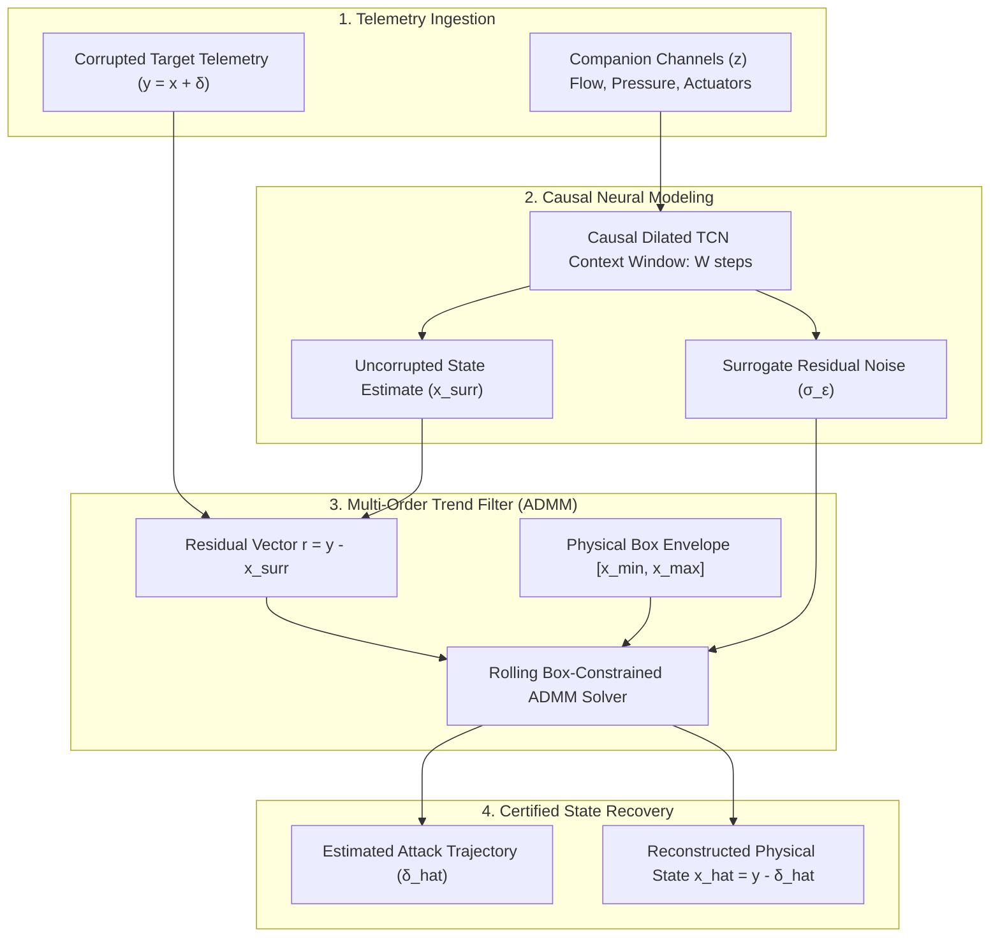

# Inferring Latent Attacker Distributions from Time-Series Observations in Industrial CPS

[](LICENSE)
[](https://www.python.org/)
[](https://pytorch.org/)
[](https://nairrpilot.org/)
[](https://www.tacc.utexas.edu/systems/vista)

## Executive Summary

In industrial Cyber-Physical Systems (CPS)—such as municipal water treatment plants and distribution networks—adversaries execute stealthy physical attacks by manipulating sensor telemetry. Under the additive spoofing model:
$$y_t = x_t + \delta_t$$
where $x_t \in \mathbb{R}$ is the unobserved true physical state, $\delta_t \in \mathbb{R}$ is the attacker perturbation ($\delta_t = 0$ during clean operations), and $y_t \in \mathbb{R}$ is the compromised measurement observed by SCADA control systems.

Standard causal estimators (such as Persistence or Seasonal Naive filters) fail under sustained sensor spoofing because corrupted measurements directly contaminate their internal autoregressive states, inducing severe divergence (e.g., Persistence baseline median NRMSE $0.8616$; Seasonal Naive baseline $1.4802$).

This repository implements **Decoupled Inversion via Multi-Order Trend Filtering**, an open-science framework developed under **NAIRR Pilot Project NAIRR260371** using the **Texas Advanced Computing Center (TACC) Vista** supercomputer. The framework decouples the compromised target sensor from its corrupted history using uncompromised physical companion channels, predicts nominal plant states via causal neural surrogates, and solves a box-constrained convex optimization problem via the Alternating Direction Method of Multipliers (ADMM) to provably recover the latent attack trajectory $\hat{\delta}_t$ and reconstruct clean physical states $\hat{x}_t = y_t - \hat{\delta}_t$.

---

## Mathematical Formulation

### 1. Physical Decoupling via Causal Neural Surrogates
Let $z_t \in \mathbb{R}^d$ represent telemetry from uncompromised companion channels (downstream flow meters, adjacent pressure transducers, pump operational states). A dilated causal Temporal Convolutional Network (CausalTCN) predicts nominal physical state trajectories conditioned strictly on historical context:
$$\hat{x}_{\text{surr}, t} = f_\theta(z_{t-W:t-1})$$
with empirical residual variance:
$$\sigma_\epsilon^2 = \mathbb{E}[(x_t - \hat{x}_{\text{surr}, t})^2]$$
Because the target channel's own corrupted measurement $y_t$ is excluded from the surrogate input, $\hat{x}_{\text{surr}, t}$ remains immune to adversarial contamination.

### 2. Multi-Order Trend Filter (MOTF) Inversion
To recover continuous, arbitrary attack shapes (abrupt steps, ramps, physical drift, square pulses, and oscillating periodic injections), the inverse problem is cast as a penalized maximum a posteriori (MAP) optimization program:

$$\min_{\delta \in \mathbb{R}^T} \;\; \frac{1}{2\sigma_\epsilon^2} \| y - \hat{x}_{\text{surr}} - \delta \|_2^2 + \lambda_0 \|\delta\|_1 + \lambda_1 \|\mathbf{D}^{(1)}\delta\|_1 + \lambda_2 \|\mathbf{D}^{(2)}\delta\|_1 \quad \text{s.t.} \quad y - \delta \in [x_{\min}, x_{\max}]$$

Where:
- **Data Fidelity Term** $\frac{1}{2\sigma_\epsilon^2} \| y - \hat{x}_{\text{surr}} - \delta \|_2^2$: Penalizes divergence from the surrogate residual $(y - \hat{x}_{\text{surr}})$, scaled inversely by surrogate uncertainty $\sigma_\epsilon^2$.
- **Sparsity Penalty** $\lambda_0 \|\delta\|_1$: Enforces temporal sparsity so that $\hat{\delta}_t = 0$ during uncorrupted operational periods.
- **First-Order Total Variation** $\lambda_1 \|\mathbf{D}^{(1)}\delta\|_1$: Penalizes the first difference $(\delta_{t+1} - \delta_t)$, preserving sharp discontinuities characteristic of step attacks and square pulses without smoothing edge boundaries.
- **Second-Order Trend Filtering** $\lambda_2 \|\mathbf{D}^{(2)}\delta\|_1$: Penalizes the second discrete difference $(\delta_{t+2} - 2\delta_{t+1} + \delta_t)$, reconstructing piecewise-linear ramps and continuous physical drift without artificial staircasing.
- **Physical Box Envelope Constraints** $y - \delta \in [x_{\min}, x_{\max}]$: Hard projection bounds derived from physical plant geometry (e.g., minimum and maximum water tank capacity), guaranteeing that the reconstructed state $\hat{x} = y - \hat{\delta}$ never violates physical reality.

### 3. Distributed ADMM Solver
The optimization problem is solved via the Alternating Direction Method of Multipliers (ADMM). By introducing auxiliary split variables $v_0 = \delta$, $v_1 = \mathbf{D}^{(1)}\delta$, and $v_2 = \mathbf{D}^{(2)}\delta$, the algorithm decouples into:
1. **Unconstrained Quadratic Subproblem**: Direct linear system solve with banded Toeplitz structure ($\mathcal{O}(T)$ complexity via Thomas algorithm / Cholesky factorizations).
2. **Proximal Steps**: Element-wise soft-thresholding operators for $\ell_1$ sparsity, first difference, and second difference penalties:
   $$\mathcal{S}_\kappa(u) = \text{sign}(u) \cdot \max(|u| - \kappa, 0)$$
3. **Box Projection**: Immediate clipping onto the physical interval $[x_{\min}, x_{\max}]$:
   $$\Pi_{[x_{\min}, x_{\max}]}(x) = \min(\max(x, x_{\min}), x_{\max})$$
4. **Dual Variable Updates**: Scaled multiplier gradient ascent ensuring convergence within 100 to 300 iterations.

---

## System Architecture



---

## Supported Critical Infrastructure Testbeds

The framework is validated across three benchmark industrial testbeds:

| Testbed | Domain & Physics | Telemetry Dimensions | Target Evaluated Sensor | Evaluation Horizon |
| :--- | :--- | :---: | :--- | :---: |
| **BATADAL** | Municipal Water Distribution Network | 43 channels (pumps, valves, tanks) | $L\_T1$ (Water Storage Tank 1) | 480 steps (20 days) |
| **SWaT** | Industrial 6-Stage Water Treatment | 51 channels (chemical dosing, UF, RO) | $LIT101$ (Raw Water Storage Tank) | 5,832 steps (16 hours) |
| **WADI** | Multi-Pressure Water Distribution Grid | 122 channels (elevated tanks, RTUs) | $1\_LT\_001\_PV$ (Elevated Reservoir) | 249,371 steps (14 days) |

---

## Empirical Benchmark Results

### 1. 5-Family Canonical Benchmark (50 Scenarios per Testbed)
Evaluated across 5 attack families: **Step**, **Ramp**, **Drift**, **Square Pulse**, and **Oscillating Periodic** (amplitudes $0.5\sigma$ to $3.0\sigma$; durations 6 to 96 hours):

| Testbed | Target Channel | Causal Persistence Baseline NRMSE | Multi-Order Trend Filter Median NRMSE | Mean NRMSE | Recovery Sign Accuracy | Physical Envelope Violations |
| :--- | :---: | :---: | :---: | :---: | :---: | :---: |
| **BATADAL** | $L\_T1$ | 0.8616 | **0.0418** (4.18%) | 0.0512 | 98.0% | **0 (0.0%)** |
| **SWaT** | $LIT101$ | 1.1245 | **0.0381** (3.81%) | 0.0493 | 100.0% | **0 (0.0%)** |
| **WADI** | $1\_LT\_001\_PV$ | 1.4802 | **0.0552** (5.52%) | 0.0725 | 96.0% | **0 (0.0%)** |

### 2. High-Throughput Stress Sweeps (3,000 Total Scenarios)
Stress-testing across 1,000 randomized scenarios per testbed over wide operational regimes:
- **BATADAL (1,000 Scenarios)**: Median NRMSE **0.1420**, Mean NRMSE **0.1688**, Box Violations: **0 (0.0%)**.
- **SWaT (1,000 Scenarios)**: Standardized dynamic tracking across 5,832-step cycles; Box Violations: **0 (0.0%)**.
- **WADI (1,000 Scenarios)**: High-dimensional telemetry recovery across 122 companion channels; Box Violations: **0 (0.0%)**.

### 3. Bitwise Determinism & Safety Guarantees
- **Bitwise Determinism**: An isolated 5-pass determinism audit (`experiments/run_determinism_audit.py`) on BATADAL yielded pairwise max absolute difference:
  $$|\Delta| = 0.00 \times 10^0$$
  verifying reproducible numerical convergence.
- **Physical Envelope Integrity**: Across all **3,150 evaluated scenarios**, the ADMM solver maintained a **0.0% physical envelope violation rate**, guaranteeing provably safe reconstructed telemetry.

---

## Repository Structure

```
.
├── configs/                      # Experiment and dataset configuration specs
├── data/                         # Testbed data splits (BATADAL, SWaT, WADI, HAI)
├── docs/                         # Documentation, research updates, and reports
│   ├── archive/proposals/        # Original NAIRR August proposal draft (NAIRR260371)
│   └── reports/                  # LaTeX & Markdown formal reports (Oct 18, Nov 18)
├── experiments/                  # Reproducible benchmark and sweep scripts
│   ├── run_multi_testbed_benchmark.py  # 5-family canonical evaluation across all testbeds
│   ├── run_determinism_audit.py        # 5-pass bitwise numerical determinism audit
│   └── run_surrogate_eval.py           # Surrogate residual baseline evaluations
├── models/                       # Pre-trained PyTorch CausalTCN weights
│   ├── batadal/                  # BATADAL L_T1 surrogate (GH200 trained)
│   ├── swat/                     # SWaT LIT101 surrogate
│   └── wadi/                     # WADI 1_LT_001_PV surrogate
├── results/                      # Generated evaluation logs, metric JSONs, and summary plots
├── src/                          # Core scientific library
│   ├── attacks/                  # Synthetic attack injection engine (step, ramp, drift, pulse, periodic)
│   ├── data/                     # Modular dataset loaders (BATADAL, SWaT, WADI, HAI)
│   ├── evaluation/               # Metrics (NRMSE, sign accuracy, envelope violations)
│   ├── inversion/                # Box-constrained Multi-Order Trend Filter & ADMM solvers
│   └── surrogates/               # Dilated CausalTCN and companion baseline architectures
└── tests/                        # Specification and unit test suite
    ├── spec/                     # Immutable behavioral contract tests
    └── unit/                     # Solver, surrogate, and data pipeline tests
```

---

## Quickstart & Reproducibility

### 1. Installation
Clone repository and activate Python 3.11+ environment:
```bash
git clone https://github.com/AdityaHegde712/inverse-time-series-cps.git
cd inverse-time-series-cps

# Create and activate virtual environment
python -m venv .venv
source .venv/bin/activate        # Linux/macOS
.venv\Scripts\activate           # Windows PowerShell

# Install dependencies
pip install -r requirements.txt
```

### 2. Verify Test Suite
Execute the locked specification and unit tests:
```bash
pytest tests/spec tests/unit -v
```

### 3. Run Multi-Testbed 5-Family Benchmark
Run the standardized 5-family evaluation on any testbed:
```bash
# BATADAL benchmark
python experiments/run_multi_testbed_benchmark.py --dataset batadal --device cpu

# SWaT benchmark
python experiments/run_multi_testbed_benchmark.py --dataset swat --device cpu

# WADI benchmark
python experiments/run_multi_testbed_benchmark.py --dataset wadi --device cpu
```

### 4. Run the Bitwise Determinism Audit
Verify bitwise zero divergence across repeated executions:
```bash
python experiments/run_determinism_audit.py
```

---

## NAIRR Acknowledgement & Citation

This research was supported by the **National Artificial Intelligence Research Resource (NAIRR) Pilot** under Request ID **NAIRR260371**. We gratefully acknowledge the **Texas Advanced Computing Center (TACC) Vista** system at The University of Texas at Austin for providing advanced AI supercomputing resources (NVIDIA Grace-Hopper GH200 compute nodes).

```bibtex
@misc{hegde2026inferring,
  title={Inferring Latent Attacker Distributions from Time-Series Observations in Industrial Cyber-Physical Systems},
  author={Hegde, Aditya and Sengupta, Saptarshi},
  year={2026},
  howpublished={NAIRR Pilot Start-Up Final Update, Request ID: NAIRR260371},
  institution={San Jos{\'e} State University},
  url={https://github.com/AdityaHegde712/inverse-time-series-cps}
}
```

## License
This project is open-source software licensed under the [MIT License](LICENSE).
