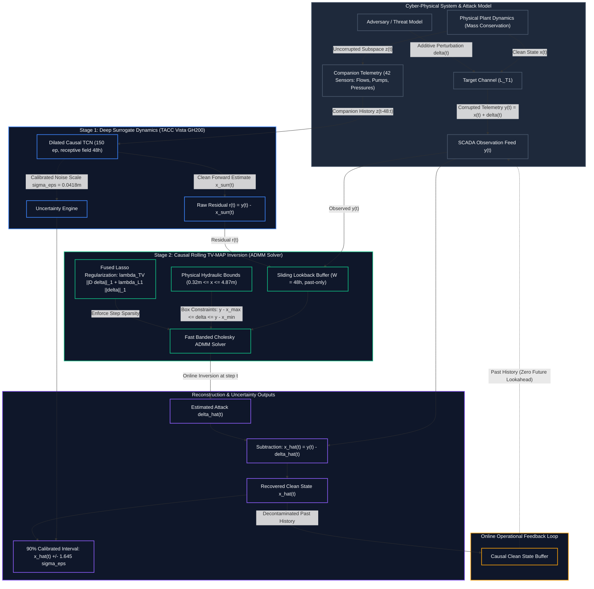

# Architecture Specification: Closed-Loop Temporal Additive Attack Inversion

This document specifies the end-to-end system architecture for real-time additive sensor attack recovery ($y_t = x_t + \delta_t$) validated on the BATADAL benchmark.

---

## 1. Interaction-First System Flowchart

---

## 2. Temporal Execution & Feedback Sequence

```mermaid
sequenceDiagram
    autonumber
    participant Plant as Physical Plant
    participant Adv as Adversary
    participant SCADA as SCADA Stream y(t)
    participant TCN as Stage 1: Dilated TCN
    participant ADMM as Stage 2: Causal Rolling Solver
    participant System as Process Controller / Historian

    Note over Plant,Adv: Hourly Time Step t
    Plant->>SCADA: Transmits compromised reading y(t) = x(t) + delta(t)
    Plant->>TCN: Transmits uncorrupted companion sensors z(t) (flows, pressures)
    
    rect rgb(20, 30, 45)
        Note over TCN: Forward State Estimation (Stage 1)
        TCN->>TCN: Computes causal convolution over companion buffer z(t-48:t)
        TCN->>ADMM: Emits clean prior estimate x_surr(t) & noise floor sigma_eps
    end

    rect rgb(20, 45, 30)
        Note over ADMM: Causal Inversion Optimization (Stage 2)
        SCADA->>ADMM: Supplies observed y(t) into sliding window [t-47 : t]
        ADMM->>ADMM: Solves TV-MAP via cached banded Cholesky factor (rho=1.0)
        ADMM->>ADMM: Applies soft thresholding & hydraulic box bounds
        ADMM->>System: Emits recovered delta_hat(t) & clean x_hat(t)
        ADMM->>System: Emits 90% confidence bounds [x_hat +/- 1.645 sigma_eps]
    end

    rect rgb(45, 35, 20)
        Note over System: Safe Causal Feedback
        System->>Plant: Dispatches control actions based on clean x_hat(t), not corrupted y(t)
    end
```

---

## 3. Structural Module Specifications

| Module | Operational Role | Key Invariant / Guarantee | Verification Metric |
| :--- | :--- | :--- | :--- |
| **Observation Feed (`SCADA`)** | Ingests continuous telemetry $y_t$ | $y_t = x_t + \delta_t$ under target channel $L_{T1}$ | Manifest hash binding |
| **Stage 1: Plant Surrogate (`DilatedTCNSurrogate`)** | Predicts physical plant state from companion subspace $S_{\text{comp}}$ | Causal 48h receptive field; zero target feedback | Validation RMSE $0.0678\,\text{m}$ ($R^2 = 0.9968$), $\sigma_\epsilon = 0.0418\,\text{m}$ |
| **Stage 2: Causal Solver (`CausalStepMAPEstimator`)** | Inverts residual $r_t = y_t - \hat{x}_t$ for $\hat{\delta}_t$ forward in time | Strict past-only causality; sliding window $W=48\,\text{h}$; ADMM Cholesky cache | Execution time: $684\,\mu\text{s}$/sample; 71.77% NRMSE cut vs. Persistence |
| **Undeclared Support Inference** | Infers attack interval $[t_{\text{start}}, t_{\text{end}}]$ autonomously | Joint $\ell_1$ sparsity and 1D Total Variation regularization | Support $F_1 = 0.9000$ (zero oracle knowledge) |
| **Uncertainty Propagation Engine** | Generates calibrated confidence intervals | Posterior variance $\sigma_\epsilon^2$ propagated to bounds | Nominal 90% coverage measured at $94.01\% - 96.01\%$; sharpness $0.1375\,\text{m}$ |
| **Hydraulic Box Projection** | Prevents physically impossible tank levels | $y_t - x_{\max} \le \delta_t \le y_t - x_{\min}$ | Hard violations $\equiv 0$ ($[0.3201, 4.8713]\,\text{m}$) |
